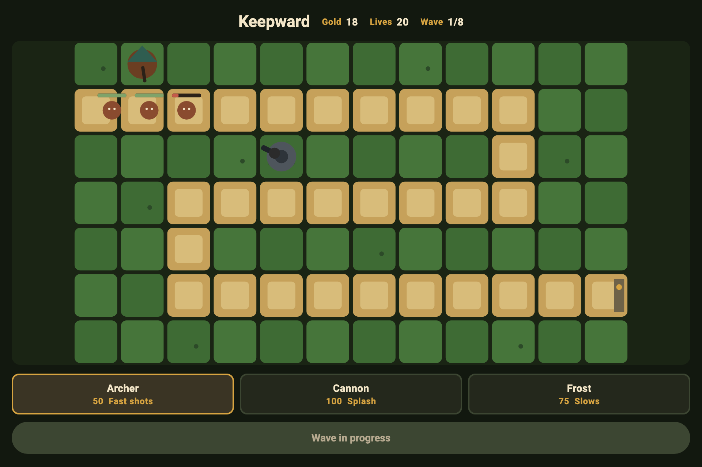

# Keepward

Keepward is a tower defence game. A column follows one road to the gate. Archers, cannons and frost towers built on the grass have to stop it.



## Play

```bash
flutter pub get
flutter run
```

Choose a tower, tap a grass tile, then press Send wave. Eight waves win the match. The match is lost when the gate runs out of lives.

## Checks

```bash
flutter analyze
flutter test
flutter test integration_test
```

## Layout

- `lib/match` is the board, the unit profiles and the simulation
- `lib/view` paints the road and the controls
- `test` covers the rules and the screen
- `integration_test` builds a tower and sends a wave
