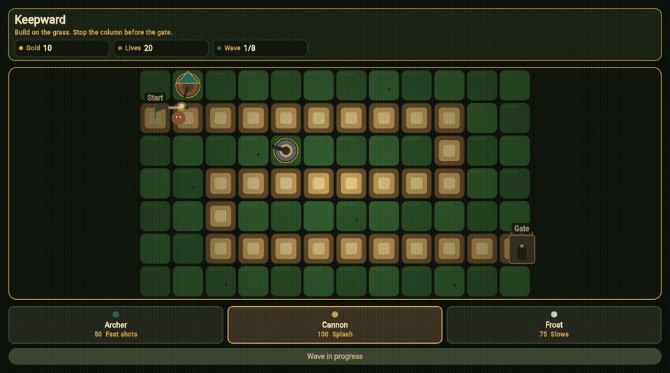

# Keepward

Keepward is a tower defence game. A column follows one road to the gate. Archers, cannons and frost towers built on the grass have to stop it.



## Play

The match runs in the browser on a phone, a tablet or a desktop:

https://alexalghisi.github.io/tower-defence-game/

The same build is on the releases page, packed to be served from the root of a static host:

https://github.com/alexalghisi/tower-defence-game/releases/tag/v1.0.0

From a checkout:

```bash
flutter pub get
flutter run -d chrome
```

Choose a tower and tap a grass tile. The next wave starts on its own, and each wave is faster than the last. The button calls that wave early. Eight waves win the match. The match is lost when the gate runs out of lives.

## Checks

```bash
flutter analyze
flutter test
flutter test integration_test
```

## Layout

- `lib/match` is the board, the unit profiles and the simulation
- `lib/view` paints the road and the controls
- `test` covers the rules and the screen
- `integration_test` builds a tower and sends a wave
